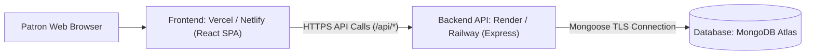

# 🎬 IMovies — Full-Stack Cinematic Movie Ticket Booking Platform

[](https://reactjs.org/)
[](https://tailwindcss.com/)
[](https://nodejs.org/)
[](https://www.mongodb.com/)
[](https://phonepe.com/)

A premium, modern full-stack movie ticket-booking application built with the MERN stack. Designed with a cinematic aesthetic, rich dark-mode gradients, smooth transitions, in-app movie discovery, interactive multi-tiered seat selection, server-side concurrency safeguards, and an authentic multi-gateway checkout featuring vector PhonePe QR payment verification and Razorpay.

---

## 🌟 Highlights & Key Features

### 1. Home & Movie Discovery
- **Cinematic Spotlight**: Hero banner showcasing featured blockbusters (*The Odyssey*, *Dhurandhar*, *Interstellar: Beyond Time*) with backdrop vignettes, trailer triggers, and direct booking actions.
- **Curated Popular Ranking Chart**: Clearly labeled sample rankings (#1 to #5) highlighting top editor picks without fabricated popularity metrics.
- **Multidimensional Filters**: Search by title, director, cast; filter by genres (*Action*, *Sci-Fi*, *Drama*, *Thriller*, *Mythology*), languages (*Hindi*, *English*, *Telugu*, *Tamil*), and availability (*Now Showing* vs. *Upcoming*).
- **Metropolitan City Selector**: Dynamic location switcher (Mumbai, Delhi-NCR, Bengaluru, Hyderabad, Chennai, Kolkata, Pune) adjusting cinemas, formats, and showtimes to the chosen city.

### 2. In-App Movie Details & Seating Experience
- **Seamless In-Page Flow**: Selecting any movie opens details and showtimes directly within the application without opening new browser tabs.
- **Cinema Hall Scheduling**: Multi-auditorium listings with screen formats (Laser IMAX, Dolby Atmos 2D, 4DX, RealD 3D).
- **Interactive Auditorium Map**:
  - Curved glowing cinema screen ("All eyes this way • Screen").
  - Three distinct pricing tiers: **Recliner (₹450)**, **Prime (₹280)**, and **Classic (₹180)**.
  - Clear aisle separation between seat columns.
  - Real-time seat status: **Available**, **Selected**, and **Booked/Disabled**.
  - Immediate total calculations including ticket base, convenience fees, and 18% GST.
  - Server-side concurrency validation to prevent double-booking collisions.

### 3. Authentication & Account Security
- Secure sign-in and account registration flows.
- Server-side password hashing using **bcryptjs** (cost factor 10). Plain-text passwords are never stored.
- JWT session management with expiration controls and protected route middleware.
- Scoped data access: Users can inspect and modify only their own profile and bookings.
- Rate limiting on sensitive endpoints via `express-rate-limit`.

### 4. Checkout & Multi-Channel Payment Experience
- **PhonePe UPI QR Integration**:
  - High-fidelity vector PhonePe QR code (`phonepe-qr.svg`) rendered at checkout.
  - Exact amount payable displayed dynamically in INR.
  - **Static QR Disclaimer Notice**: Clearly explains that scanning a static QR code in a mobile UPI app does not automatically transmit confirmation to the web server.
  - **12-Digit Numeric UTR Verification**: Patrons submit the 12-digit transaction reference (UTR) from PhonePe/GPay/Paytm. The server validates the format, locks seats atomically, and issues a confirmed e-ticket.
- **Razorpay Secure Gateway**:
  - Client-side order generation and server-side secret handling.
  - Webhook verification endpoint and cryptographic HMAC SHA-256 signature checking.
- **Explicit Demo Sandbox Mode**:
  - Per requirements, clearly demarcated with warning badges to differentiate evaluation testing from actual financial transactions.

### 5. My Tickets Dashboard
- Real-time view of all user reservations.
- **Strict Status Distinction**: Confirmed tickets show digital boarding passes and QR codes; unverified reservations clearly display **Payment Pending** and never appear confirmed prematurely.
- Print/Save ticket option formatted for physical or PDF archiving.

### 6. Profile Management
- View and update legal name, email, and phone number.
- Server-side validation and immediate profile refresh.
- Clear, accessible sign-out action.

### 7. Administrative Console
- Platform KPI metrics: Total Revenue, Total Bookings, Confirmed Bookings, Active Movies, Registered Users.
- Catalog management: Add new movies with genres, runtimes, certificates, and artwork URLs.
- Comprehensive live transaction feed across all patrons.

---

## 📁 Project Architecture

```
imovies/
├── backend/                         # Node.js & Express REST API
│   ├── src/
│   │   ├── config/
│   │   │   └── db.js                # MongoDB connection handler
│   │   ├── controllers/
│   │   │   ├── adminController.js   # Metrics and catalog management
│   │   │   ├── authController.js    # JWT login, register & profile updates
│   │   │   ├── bookingController.js # Seat validation, intent & booking fetch
│   │   │   ├── movieController.js   # Catalog query, filters & ranking
│   │   │   ├── paymentController.js # PhonePe UTR, Razorpay & Demo processing
│   │   │   └── showController.js    # Shows, cinemas & seat layout queries
│   │   ├── middleware/
│   │   │   ├── auth.js              # Token verification & role checking
│   │   │   └── rateLimiter.js       # Express rate limiter configuration
│   │   ├── models/
│   │   │   ├── Booking.js           # Booking schema & reference generator
│   │   │   ├── Cinema.js            # Theatres, cities & auditorium screens
│   │   │   ├── Movie.js             # Film details, certificates & ratings
│   │   │   ├── Payment.js           # Transaction logs, UTR & gateway orders
│   │   │   ├── Show.js              # Screen schedules, tiers & bookedSeats
│   │   │   └── User.js              # Users, bcrypt hashing & roles
│   │   ├── routes/                  # Express route mounting
│   │   ├── seeds/
│   │   │   └── seedData.js          # Full database seeder with sample data
│   │   └── server.js                # Express app entry & error middleware
│   ├── .env.example                 # Backend environment variable template
│   └── package.json
│
├── frontend/                        # React 18 + Vite SPA
│   ├── public/
│   │   └── phonepe-qr.svg           # High-resolution PhonePe vector QR
│   ├── src/
│   │   ├── components/              # Modular UI components
│   │   │   ├── AuthModal.jsx
│   │   │   ├── BookingSuccessModal.jsx
│   │   │   ├── CheckoutModal.jsx
│   │   │   ├── CitySelectorModal.jsx
│   │   │   ├── FeaturedBanner.jsx
│   │   │   ├── FilterBar.jsx
│   │   │   ├── Footer.jsx
│   │   │   ├── MovieCard.jsx
│   │   │   ├── MovieDetailsModal.jsx
│   │   │   ├── Navbar.jsx
│   │   │   ├── PopularRankingChart.jsx
│   │   │   ├── SeatMapModal.jsx
│   │   │   └── TicketCard.jsx
│   │   ├── context/
│   │   │   ├── AuthContext.jsx      # Authentication state & actions
│   │   │   └── BookingContext.jsx   # Booking flow state & pricing logic
│   │   ├── pages/
│   │   │   ├── AdminPage.jsx
│   │   │   ├── HomePage.jsx
│   │   │   ├── MyTicketsPage.jsx
│   │   │   └── ProfilePage.jsx
│   │   ├── services/
│   │   │   └── api.js               # API service with offline mock fallback
│   │   ├── App.jsx
│   │   ├── index.css                # Tailwind CSS layers & cinematic styles
│   │   └── main.jsx
│   ├── index.html
│   ├── vite.config.js
│   ├── tailwind.config.js
│   ├── postcss.config.js
│   └── package.json
│
└── standalone/                      # Zero-Dependency Standalone Browser Edition
    ├── index.html                   # 100% interactive standalone single-file app
    └── phonepe-qr.svg               # Vector PhonePe QR code
```

---

## 🚀 Quick Start Guide

### Option A: Instant Browser Preview (Zero Installation)
If Node.js is not yet installed on your system or you wish to immediately test the end-to-end interface:
1. Navigate to `standalone/index.html`.
2. Double-click to open in any web browser (Chrome, Edge, Firefox, Safari).
3. **Or run with Python's built-in HTTP server**:
   ```bash
   cd standalone
   python -m http.server 3000
   ```
   Open `http://localhost:3000` (auto-redirects to `http://localhost:3000/imovies`) to interact with the full application!

---

### Option B: Full MERN Stack Setup

#### 1. Prerequisites
- **Node.js** v18+ and **npm** v9+ installed.
- **MongoDB** running locally on `mongodb://127.0.0.1:27017` OR a free cluster from **MongoDB Atlas**.

#### 2. Backend Setup
```bash
cd backend
npm install
```

Create your `.env` file from the provided example:
```bash
cp .env.example .env
```

Verify your environment configuration in `backend/.env`:
```env
PORT=5000
NODE_ENV=development
MONGODB_URI=mongodb://127.0.0.1:27017/imovies
JWT_SECRET=your_jwt_secret_key_min_32_characters_here
JWT_EXPIRES_IN=7d
CLIENT_URL=http://localhost:5173/imovies
APP_URL=http://localhost:5000/imovies

# Optional: Razorpay test keys (leave as-is for demo mode)
RAZORPAY_KEY_ID=rzp_test_placeholder
RAZORPAY_KEY_SECRET=rzp_secret_placeholder
RAZORPAY_WEBHOOK_SECRET=rzp_webhook_secret_placeholder

# PhonePe VPA
PHONEPE_MERCHANT_VPA=imovies@upi
PHONEPE_MERCHANT_NAME=IMovies Entertainment Pvt Ltd
```

#### 3. Seed Initial Database Records
Populate users, movies (*The Odyssey*, *Dhurandhar*, etc.), cinemas across 5 major cities, and schedules:
```bash
npm run seed
```

Default credentials seeded:
- **Standard User**: `user@imovies.com` / `password123`
- **Admin User**: `admin@imovies.com` / `password123`

#### 4. Launch Backend API
```bash
npm run dev
# Or for standard production start:
npm start
```
The API server will listen on `http://localhost:5000/imovies`. Health check endpoints:
- `http://localhost:5000/imovies`
- `http://localhost:5000/imovies/api/health`

#### 5. Frontend Setup
In a new terminal window:
```bash
cd frontend
npm install
```

Create frontend `.env` file:
```bash
cp .env.example .env
```

Launch the Vite development server:
```bash
npm run dev
```
Open `http://localhost:5173/imovies/` in your browser.

---

## 🔒 Concurrency & Seat Locking Engine

To prevent two patrons from reserving the same seat at the same time:
1. **Server-Side Validation**: Seat pricing and availability are strictly computed on the server. The client only sends requested seat identifiers.
2. **Atomic Ingestion**: When payment is verified via UTR or Razorpay signature, MongoDB's atomic operator `$addToSet` is executed:
   ```javascript
   await Show.findByIdAndUpdate(booking.show, {
     $addToSet: { bookedSeats: { $each: seatNumbers } }
   });
   ```
3. **Collision Detection**: If another user has reserved any of the selected seats during the checkout window, the verification endpoint halts with an `HTTP 409 Conflict`, issues a cancellation on the booking record, and instructs the user to select alternative seats.

---

## 💳 Payment Gateway & Webhook Setup

### PhonePe UPI Verification
1. Patron scans the QR code in their PhonePe / UPI app and transfers the exact amount.
2. Patron enters the **12-digit numeric UTR** into the checkout verification field.
3. API endpoint `POST /api/payments/phonepe/verify` validates the 12-digit format, ensures the show has not expired, confirms seat exclusivity, records the UTR, and flips the booking status to `confirmed`.

### Razorpay Integration
1. Generate Razorpay Key ID and Secret from the [Razorpay Dashboard](https://dashboard.razorpay.com/#/access/api-keys).
2. Set `RAZORPAY_KEY_ID` and `RAZORPAY_KEY_SECRET` in `backend/.env`.
3. Set `VITE_RAZORPAY_KEY_ID` in `frontend/.env`.
4. In Razorpay Webhooks settings, register your backend webhook URL:
   `https://your-api-domain.com/api/payments/razorpay/webhook`
   with the event `payment.captured`. Set the secret to match `RAZORPAY_WEBHOOK_SECRET`.

---

## ☁️ Deployment Guidance

> [!IMPORTANT]
> **Static Hosts (GitHub Pages, Netlify Static) Limitation**:
> A purely static hosting platform such as **GitHub Pages cannot execute the Node.js / Express backend** or establish MongoDB TCP connections. Attempting to host the full MERN stack on GitHub Pages will fail to serve API requests.

### Recommended Full-Stack Deployment Architecture



### 1. Database: MongoDB Atlas (Free Tier)
1. Sign up at [mongodb.com/atlas](https://www.mongodb.com/atlas).
2. Create a free shared cluster.
3. In Network Access, add IP `0.0.0.0/0` (allow access from anywhere).
4. In Database Access, create a database user and password.
5. Obtain your connection string:
   `mongodb+srv://<username>:<password>@cluster0.mongodb.net/imovies?retryWrites=true&w=majority`

### 2. Backend: Render or Railway
1. Push your repository to GitHub.
2. On [Render](https://render.com), create a new **Web Service** pointing to the `backend/` folder.
3. Set the build command to `npm install` and start command to `npm start`.
4. Add environment variables:
   - `MONGODB_URI`: Your MongoDB Atlas connection URI
   - `JWT_SECRET`: Random 32+ character string
   - `CLIENT_URL`: Your deployed frontend domain (e.g. `https://imovies.vercel.app`)
   - `NODE_ENV`: `production`

### 3. Frontend: Vercel or Netlify
1. On [Vercel](https://vercel.com), create a new project from your repository.
2. Set the root directory to `frontend`.
3. Configure the build command: `npm run build` and output directory: `dist`.
4. Add the environment variable:
   - `VITE_API_BASE_URL`: `https://your-render-backend.onrender.com/api`
5. Deploy!

---

## 🧪 Verification & Acceptance Checklist

| Feature | Requirement | Status |
| :--- | :--- | :---: |
| **Movie Discovery** | Featured banner with *The Odyssey* & *Dhurandhar* | ✅ Verified |
| **Rankings** | Sample editor ranking clearly labeled without fake stats | ✅ Verified |
| **City Selection** | Location switcher adapting cinemas to region | ✅ Verified |
| **Details & Booking** | In-app view without opening a new browser tab | ✅ Verified |
| **Seat Map** | Multi-tier layout (Recliner, Prime, Classic), live totals | ✅ Verified |
| **Concurrency** | Server-side validation preventing double-booking | ✅ Verified |
| **Authentication** | bcryptjs hashing, JWT tokens, protected routes | ✅ Verified |
| **PhonePe QR** | Vector QR rendered with exact price & 12-digit UTR input | ✅ Verified |
| **QR Disclaimer** | Static QR limitation clearly documented to user | ✅ Verified |
| **Demo Mode** | Clearly labeled sandbox mode separated from live gateways | ✅ Verified |
| **My Tickets** | Confirmed tickets vs. pending payments strictly distinguished | ✅ Verified |
| **My Profile** | View & update name/email, clear sign-out action | ✅ Verified |
| **Admin Area** | Platform metrics, movie catalog management, booking logs | ✅ Verified |

---

## 📄 License
This project is released under the [MIT License](LICENSE).
